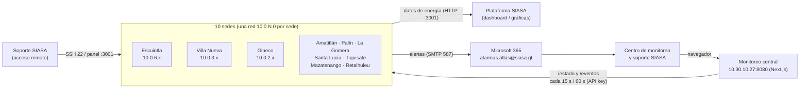
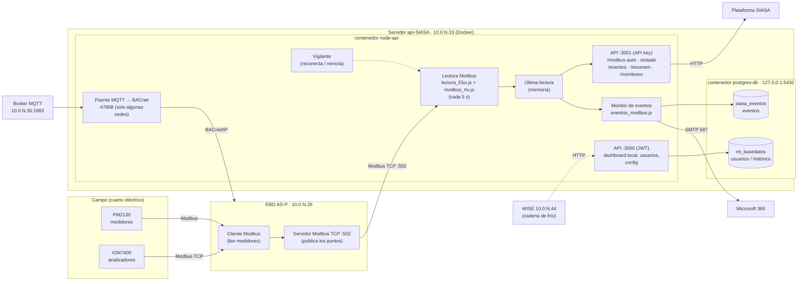
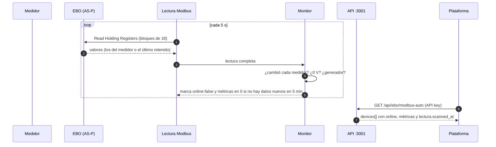
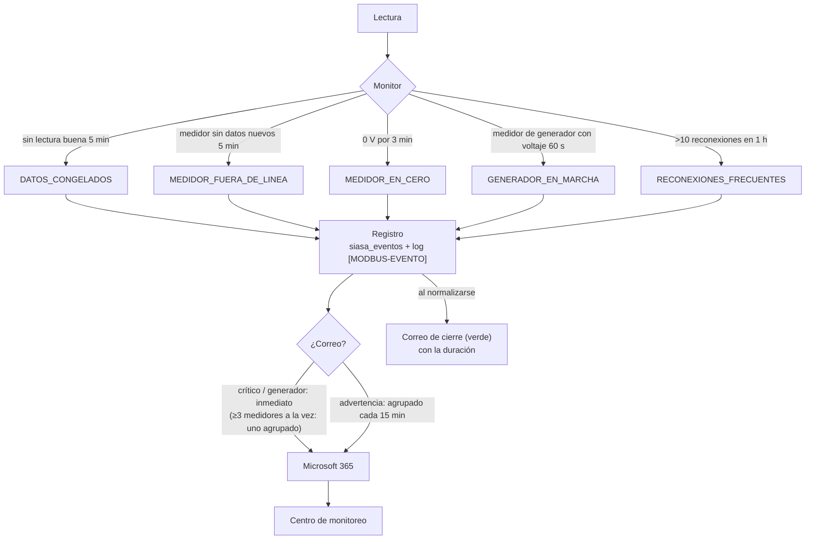
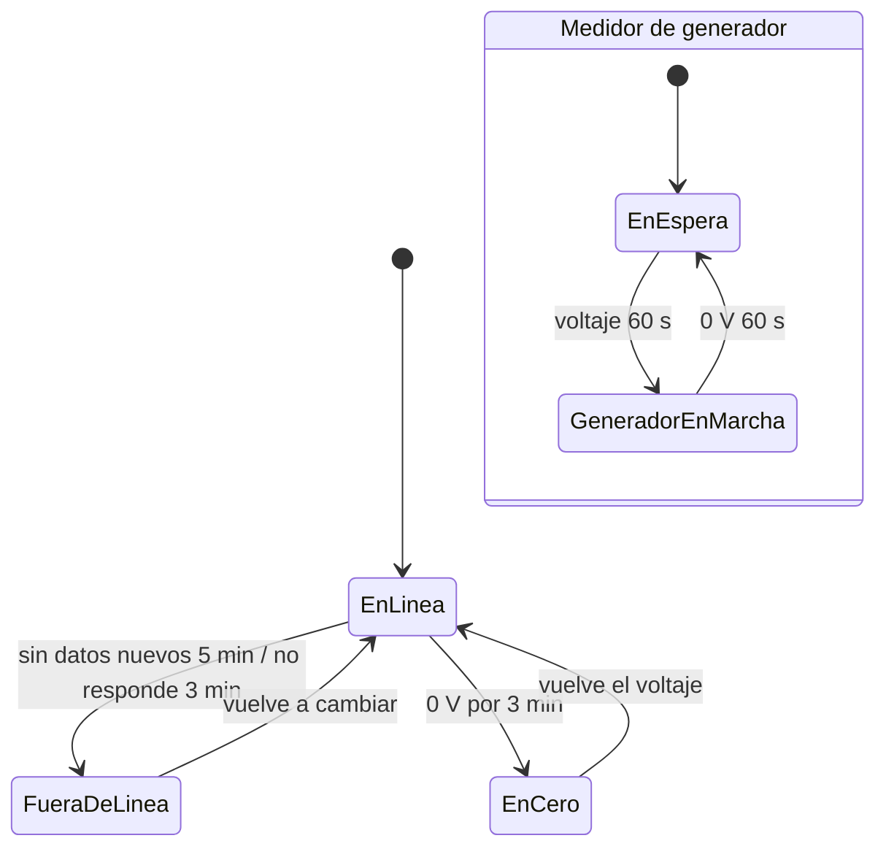

# Arquitectura general de api-SIASA en las sedes del IGSS

| | |
|---|---|
| **Alcance** | Las 10 sedes: Escuintla, Villa Nueva, Gineco, Amatitlán, Palín, La Gomera, Santa Lucía, Tiquisate, Mazatenango y Retalhuleu |
| **Dirigido a** | Soporte SIASA, equipo de la plataforma y centro de monitoreo |
| **Actualizado** | 20/10/2026 |
| **Relacionado** | [Inventario y operación de las sedes](../operacion/sedes-api-siasa.md) |

Los diagramas están en Mermaid (se ven como gráficos en VS Code y GitHub). Debajo de cada uno hay una versión en texto.

---

## 1. Vista general

Las 10 sedes tienen la **misma arquitectura**, repetida: cada hospital tiene su EBO (AS-P de EcoStruxure) que lee los medidores, y un servidor propio con api-SIASA que lee el EBO y entrega los datos. No hay un servidor central de datos: cada sede es independiente, y solo comparten la cuenta de correo de alertas y el modelo de software.



**Monitoreo central:** el servidor `10.30.10.27` consulta las 10 sedes y las muestra en una sola vista en `http://10.30.10.27:8080` (Next.js 14, contenedor `monitoreo-central`). Las API keys de las sedes están solo en ese servidor; el navegador usa una clave propia del panel. No envía correos: cada sede envía los suyos. Ver [`monitoreo-central/README.md`](../../monitoreo-central/README.md).

```
              +--------------------- 10 sedes, mismo esquema ----------------------+
              |  Escuintla  Villa Nueva  Gineco  Amatitlán  Palín  La Gomera        |
              |  Santa Lucía  Tiquisate  Mazatenango  Retalhuleu                    |
              +---------------------------------------------------------------------+
                   | HTTP :3001 (datos)        | SMTP 587 (alertas)        ^ SSH 22 / panel
                   v                           v                           |
           Plataforma SIASA            Microsoft 365  ---> Centro de    Soporte SIASA
           (dashboard)                 (correo)            monitoreo
```

---

## 2. Arquitectura de una sede

Patrón de direcciones por sede: **EBO `10.0.N.26`**, **servidor `10.0.N.33`**, broker MQTT de sensores `10.0.N.35`, WISE `10.0.N.44`.



```
 CAMPO                         EBO AS-P 10.0.N.26                SERVIDOR 10.0.N.33 (Docker)
 +---------+                  +----------------------+          +-------------------------------------------+
 | PM2130  |--Modbus--------->| cliente Modbus       |          | node-api                                  |
 | ION7400 |--Modbus TCP----->|   (lee medidores)    |          |  lectura Modbus (cada 5 s) --> memoria    |
 +---------+                  | servidor Modbus :502 |<--TCP----|  monitor de eventos  --> siasa_eventos    |
                              +----------------------+          |  vigilante (reconecta / reinicia)         |
                                       ^                        |  API :3001 (API key) ---> Plataforma      |
                                       | BACnet/IP              |  API :3000 (JWT)                          |
                              +--------+---------+              |  puente MQTT->BACnet (algunas sedes)      |
                              | broker MQTT .35  |------------->|                                           |
                              +------------------+              | postgres-db (solo 127.0.0.1:5432)         |
                                                                |  siasa_eventos | mi_basedatos             |
                                                                +---------------------+---------------------+
                                                                                      | SMTP 587
                                                                                      v
                                                                              Microsoft 365 -> correo
```

### 2.1 Componentes

| Componente | Dónde | Qué hace |
|---|---|---|
| **PM2130 / ION7400** | Tableros del hospital | Miden voltaje, corriente, potencias, energía, calidad (ION) y transferencia comercial/generador (ION) |
| **EBO AS-P** | `10.0.N.26` | Lee los medidores como cliente Modbus y los **republica** en su servidor Modbus TCP (puerto 502). Si pierde un medidor, **retiene el último valor** |
| **Lectura Modbus** | `node-api` · `modbus_cliente/lectura_Ebo.js`, `modbus_rtu.js` | Lee el EBO cada 5 s por bloques de registros. `modbus_rtu.js` tiene la corrección del atasco (cierre con límite de 3 s) |
| **Última lectura** | Memoria de `node-api` | La API responde desde aquí (no consulta al EBO en cada petición) |
| **Monitor de eventos** | `node-api` · `monitoreo/eventos_modbus.js` | Evalúa cada lectura y cada medidor; marca `online: "false"`; abre y cierra eventos; envía correos |
| **Vigilante** | Dentro del monitor | Lectura atascada 60 s → reconecta; 10 min → reinicia el proceso (Docker lo levanta) |
| **API :3001** | `node-api` | Para la plataforma y el monitoreo, con API key |
| **API :3000** | `node-api` | Dashboard local, usuarios, configuración (JWT) |
| **Puente MQTT → BACnet** | `node-api` · `bacnet/mqtt_to_bacnet_bridge.js` | Publica en BACnet los sensores LoRa/MQTT del broker `10.0.N.35`. Activo en Escuintla y Gineco |
| **postgres-db** | Solo `127.0.0.1:5432` | `siasa_eventos`: eventos y notificaciones (usuario propio). `mi_basedatos`: usuarios y datos históricos (solo `admin`; la inserción de métricas está apagada) |
| **Microsoft 365** | Externo | Envío de correos (`smtp.office365.com:587`) |

### 2.2 Puertos del servidor

| Puerto | Servicio | Expuesto a |
|---|---|---|
| 22 | SSH (soporte) | Red de la sede / acceso remoto |
| 3000 | API con JWT (dashboard local) | Red |
| 3001 | API con API key (datos, estado, eventos, resumen, panel) | Red |
| 502 tcp/udp | Publicado por el contenedor (Modbus) | Red |
| 47808 udp | BACnet/IP del puente MQTT → BACnet | Red |
| 5432 | Postgres | **Solo el propio servidor** (desde el 14-20/10/2026) |

**Conexiones salientes:** EBO `10.0.N.26:502` (Modbus TCP), `smtp.office365.com:587` (correo), broker MQTT `10.0.N.35:1883` (sedes con puente), WISE `10.0.N.44`, SQL Server `10.30.39.172` instancia `ION` (procedimiento `nsp.usp_modbus_auto_json`, endpoint `/api/ebo/modbus_calidadenergia`).

---

## 3. Flujo de datos



1. El EBO lee cada medidor y publica sus valores en registros Modbus.
2. La API lee los registros cada 5 s y arma un dispositivo por medidor.
3. El monitor compara con la lectura anterior. Si un medidor no cambia en 5 min (el EBO repite el último valor), lo marca **`online: "false"`** con **métricas en 0**.
4. La plataforma consulta `/api/ebo/modbus-auto` y recibe todos los medidores, con su estado y la hora de la lectura (`lectura.scanned_at`, `lectura.stale`).

---

## 4. Flujo de alertas



| Regla | Efecto |
|---|---|
| Un correo al abrir y uno al cerrar | Sin repeticiones ni recordatorios |
| Reinicio de la API | Recupera de `siasa_eventos` los eventos abiertos ya notificados: **no repite correos** |
| 3 o más medidores a la vez | **Un solo** correo agrupado (probable falla del EBO o del bus) |
| Límite | 20 correos por hora por sede; si el correo falla, reintenta |

### 4.1 Estados de un medidor



| Estado | `online` en la API | Correo |
|---|---|---|
| En línea | `"true"` | — |
| Fuera de línea | `"false"`, métricas en 0 | Rojo al entrar, verde al salir |
| En cero (medidor comunicando, 0 V) | `"true"` | Rojo al entrar, verde al salir |
| En espera (medidor de generador, generador apagado) | `"true"` | — |
| Generador en marcha | `"true"` | Azul al entrar, verde al salir |

---

## 5. Despliegue en el servidor

```
/home/api/
├── node-postgres-docker/
│   ├── docker-compose.yml          servicios api (node-api) y postgres (postgres-db); rotación del log
│   └── api/                        montado en /app dentro de node-api
│       ├── index.js                API :3000 y :3001, lectura periódica, conexión con el monitor
│       ├── .env                    configuración y claves de la sede (solo en el servidor)
│       ├── modbus_cliente/         lectura_Ebo.js, modbus_rtu.js, lectura_Ebo_v2.js (apagado)
│       ├── monitoreo/              eventos_modbus.js, plantilla_correo.js, panel.html, node_modules/nodemailer
│       ├── bacnet/                 puente MQTT → BACnet y utilidades BACnet
│       ├── wise_cliente/           lectura WISE
│       ├── auth/                   usuarios y JWT
│       └── public/                 dashboard local (:3000)
└── respaldos/<fecha>-<sede>/       antes/ (archivos previos), logs/, .clave_siasa_eventos
```

| Contenedor | Imagen | Reinicio | Log |
|---|---|---|---|
| `node-api` | `node-postgres-docker_api` (Node 18/20) | `always` | json-file, 50 MB × 10 |
| `postgres-db` | `postgres:16` | `always` | json-file, 50 MB × 10 |

El código está montado desde `api/`: un cambio de código o de `.env` se aplica con `docker restart node-api`.

---

## 6. Las 10 sedes

| Sede | Servidor | EBO | Medidores (PM2130 + ION7400) | Particularidad |
|---|---|---|---|---|
| Escuintla | 10.0.6.33 | 10.0.6.26 | 7 + 6 = 13 | Sede modelo · puente MQTT → BACnet |
| Villa Nueva | 10.0.3.33 | 10.0.3.26 | 6 + 1 = 7 | — |
| Gineco | 10.0.2.33 | 10.0.2.26 | 6 + 2 = 8 | Puente MQTT → BACnet · `MODBUS_AUTO_SKIP_REGISTERS=255,256` |
| Amatitlán | 10.0.4.33 | 10.0.4.26 | 3 + 1 = 4 | — |
| Palín | 10.0.5.33 | 10.0.5.26 | 3 + 1 = 4 | — |
| La Gomera | 10.0.7.33 | 10.0.7.26 | 3 + 1 = 4 | Red con cortes (ZeroTier) |
| Santa Lucía | 10.0.8.33 | 10.0.8.26 | 3 + 1 = 4 | — |
| Tiquisate | 10.0.9.33 | 10.0.9.26 | 1 + 1 = 2 | — |
| Mazatenango | 10.0.10.33 | 10.0.10.26 | 6 + 1 = 7 | `MODBUS_AUTO_SKIP_REGISTERS=273,274` |
| Retalhuleu | 10.0.11.33 | 10.0.11.26 | 3 + 1 = 4 | HDR052 es medidor de generador (`MEDIDORES_GENERADOR=HDR052`) |
| **Total** | | | **41 + 16 = 57** | |

Inventario completo de medidores y configuración: [sedes-api-siasa.md](../operacion/sedes-api-siasa.md).

### 6.1 Software común y propio de cada sede

| Pieza | Igual en las 10 sedes | Propio de cada sede |
|---|---|---|
| `monitoreo/` (monitor, plantilla, panel) | Sí | Solo la configuración en `.env` |
| `modbus_rtu.js` (corrección del atasco) | Sí | IP del EBO por defecto |
| `index.js` | Base común (Villa Nueva corregido) | Escuintla propio; Gineco con puente; Mazatenango y Retalhuleu con un cambio cada una |
| `lectura_Ebo.js` | Mapa de registros por sede | Gineco y Mazatenango con salto de registros |
| `.env` | Umbrales, correo y reglas | Nombre, prefijo, URL, claves, `MEDIDORES_GENERADOR`, `MODBUS_AUTO_SKIP_REGISTERS` |

---

## 7. Seguridad

| Aspecto | Estado |
|---|---|
| Postgres | Solo `127.0.0.1`; `siasa_eventos` con usuario propio; `mi_basedatos` solo `admin` |
| API :3001 | API key por sede |
| Claves | Solo en el `.env` de cada servidor; ninguna en los documentos |
| Correo | Cuenta única `alarmas.atlas@siasa.gt` para las 10 sedes |
| **Pendiente** | Los 10 servidores son clones con la **misma llave SSH y machine-id**; claves por defecto de Postgres (`admin/admin123`) y `JWT_SECRET`; cambiar la clave del buzón de alarmas |

---

## 8. Limitaciones conocidas

| Limitación | Consecuencia | Mitigación |
|---|---|---|
| El EBO retiene el último valor de un medidor sin comunicación | La lectura Modbus no falla | Detección por valores sin cambio (5 min) |
| Si el servidor o la red caen, la sede no puede avisar | No llega correo | Vigilancia externa ([plan de monitoreo](../operacion/plan-monitoreo-api-siasa.md)); consultar `/estado` o `/resumen` |
| Medidor de generador con el generador apagado | No se distingue un medidor desconectado (también da 0) | Se avisa al arrancar el generador |
| Puntos no publicados en el EBO (Gineco, Mazatenango) | Esos valores siempre en 0 | Publicarlos en la AS-P si se necesitan |
| Red hacia las sedes con cortes (ZeroTier) | Acceso de soporte intermitente (La Gomera: 4 h 40 min el 19/10) | Revisar la conexión de la sede |
